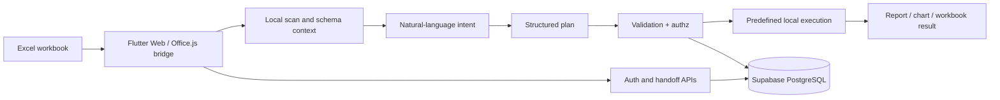

# InsightFlow Architecture

## Technology stack

- Frontend: Flutter/Dart in `apps/flutter_app/`; Flutter Web and Office.js integration.
- Backend: Python, FastAPI, SQLAlchemy, pandas, and domain modules at repository root.
- Persistence: PostgreSQL/Supabase with SQL migrations in `migrations/`.
- Identity: Firebase/Supabase provider adapters in `firebase_authz/` and Flutter auth services.
- CI/CD: GitHub Actions in `.github/workflows/`.
- Hosting: Cloudflare Pages for the public Flutter frontend, a Cloudflare Worker API gateway, and an Oracle Cloud VM for the production FastAPI service. Supabase provides authentication and PostgreSQL persistence. Render is excluded from the main website backend path.

## Repository structure

```text
apps/flutter_app/       Flutter UI, auth, analysis, Excel bridge, tests
core/                    Database, Excel handoff, shared backend services
firebase_authz/          Identity, authorization, management routes/providers
dataset_storage/         Managed dataset lifecycle and routes
excel_auth_handoff/      One-time Excel authentication handoff
secure_excel/            Excel-safe API surface and conversation state
schema_intelligence/     Schema and semantic-role analysis
query_history/           Query history services
plan_cache/ sql_cache/   Bounded plan and SQL caching boundaries
migrations/              Ordered PostgreSQL migrations
tests/                   Python unit, integration, security, and contract tests
.github/workflows/       CI, Pages, security, migrations, and deployment checks
```

## Runtime flow



## Service boundaries

- `main.py` registers application routes and core analysis endpoints.
- `secure_excel/routes.py` exposes Excel-safe operations, conversation state, and constrained execution.
- `firebase_authz/routes.py` and `management_routes.py` expose identity, profile, membership, role, dataset, request, and audit operations.
- `dataset_storage/routes.py` owns managed dataset metadata, profiles, rows, versions, proposals, working copies, grants, and downloads.
- `excel_auth_handoff/routes.py` owns short-lived create/complete/claim/cancel handoff state.

Representative route evidence is in `main.py`, `secure_excel/routes.py`, `firebase_authz/routes.py`, `firebase_authz/management_routes.py`, and `dataset_storage/routes.py`.

## Authentication and authorization

Flutter auth services establish the session. Backend provider adapters verify identity. Authorization resolves organization/workspace/resource scope and is enforced in backend routes and storage services. Client UI capability policy is not a security boundary.

## Database architecture

Ordered SQL migrations create application tables, authorization structures, managed dataset storage, profile data, RLS policies, Excel handoff state, indexes, triggers, and audit structures. `tools/run_authz_migrations.py` tracks applied versions and verifies required structures.

## Local versus remote data

Workbook content is intended to remain local by default. The outbound privacy guard and privacy-mode settings constrain remote AI requests. Metadata-only or explicitly enabled remote paths must still pass policy and validation.

## Deployment architecture

Cloudflare Pages builds and serves `apps/flutter_app` as the public frontend. The
frontend calls `https://insightflow-api.jaiphotoshoot.workers.dev`; the Worker
preserves methods, paths, query strings, request bodies, authorization headers,
status codes, and response headers while forwarding to the Oracle VPC binding.
The Oracle VM runs `uvicorn main:app --host 127.0.0.1 --port 8000` behind its
HTTPS reverse proxy and systemd service, and uses Supabase for authentication and
PostgreSQL persistence. Render is not part of the main website runtime path.
The public API origin is supplied through the `INSIGHTFLOW_BACKEND_URL`
repository variable.

## Limitations

- The repository contains multiple legacy and current route families; route ownership must be checked before edits.
- Some documentation and source terminology can drift; claims here require source and workflow verification.
- Advisory schema and relationship inference requires business validation.
